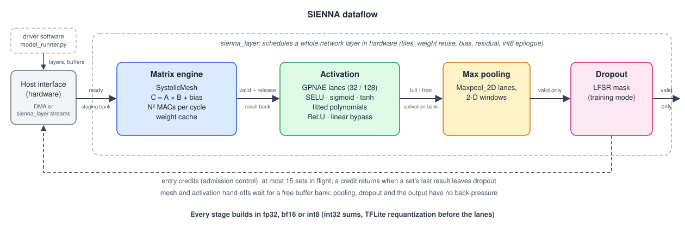

# SIENNA

**A neural-network inference accelerator in SystemVerilog that runs real TensorFlow Lite models in fp32, bf16 and int8.**

SIENNA multiplies matrices on a streaming systolic mesh, applies SELU, sigmoid or tanh on a bank of polynomial activation lanes, then pools and applies dropout. Every stage works on a different set of data at the same time. A Python host stack lowers TFLite models onto it, so a whole ResNet-8 inference runs on the hardware in simulation.

| | |
|---|---|
| **7.43 TFLOPS** sustained | 64 × 64 mesh streaming matrix multiplies at 95.5% of peak, in fp32, bf16 and int8 |
| **14 µs** per ResNet-8 inference | CIFAR-10 image on the 64 × 64 mesh, every multiply-accumulate on the RTL |
| **0 of 198 656** int8 outputs off | int8 layers converted from TensorFlow Lite, each output within 1% or one output step of the exact result (10% for activation functions; measured worst: half a step) |
| **58× fewer cycles** per activation | than the published TYTAN engine it grew from (747 → 12.8 cycles for tanh on one fp32 lane) |
| **up to 16× faster** on small layers | by packing many small matrix multiplies into one |

Times assume a 950 MHz clock ([why](#performance)).

---

## Architecture



Work moves through SIENNA in *sets*: one N × N matrix multiplied by another, then the activation function on the result. What makes it fast, stage by stage:

- **Matrix engine** ([SystolicMesh](https://github.com/SoHam-56/SystolicMesh)). The mesh is a grid of small systolic arrays, and each one computes its own block of the result from start to finish, so they all finish together and nothing has to be combined afterwards. Inputs, running sums and results each have spare buffers, so the next set loads while the current one multiplies and the previous result is read out. Weights that a layer reuses stay in an on-chip cache instead of being sent again.
- **Activation** ([GPNAE](https://github.com/SoHam-56/GPNAE)). Sigmoid, tanh and SELU are usually computed from e^x, which takes a long series of terms and, for sigmoid and tanh, a slow division. SIENNA instead approximates each function directly with a few short polynomial pieces, which need only multiplies and adds, and outputs the function's limit where the true value is already within tolerance of it. A tanh takes about 13 cycles in fp32 instead of 747 in the published design. The coefficients are data in a small memory the host can rewrite between layers (`coef_ready_o` says when; a write while anything is in flight is refused), in three accuracy tiers (within 1%, 5% and 10%) that each layer picks from; the lower tiers take fewer cycles. Each lane's multiply-add unit works on many inputs in turn, so it starts a new operation every cycle, and 32 lanes run side by side.
- **Pipeline.** Up to 15 sets are in flight at once, each stage working on a different one, and each set can use a different activation function. Every boundary, from the host interface to the output, is the same *credit link*: the receiving side grants one credit per free buffer slot, and the sending side sends only while it holds one. Nothing can overrun or be dropped, and a slow consumer at the output simply holds the pipeline back, stage by stage, until it is ready. The host interface is hardware (a DMA engine, or the layer engine's input streams).
- **One top.** `sienna_top` is the only top module. `SET_PORT` chooses how a host drives it, at the wires; by design neither choice adds a register or moves a cycle:
  - `SET_PORT = 0`, the layer contract: a layer's configuration, then its rows on two streams, which the layer engine below turns into sets.
  - `SET_PORT = 1`, the set contract: one put per set with its settings, its bias and its rows (a DMA engine, or a testbench).
  - `COPIES` puts several pipelines behind one set-contract host, which sends sets to them in turn.
- **Layer engine.** On the layer contract, `sienna_sched` runs a whole network layer on its own. It splits the layer into sets, reuses weights, and adds the bias and any skip connection. It handles depthwise convolution and, in int8, the rescaling of each output channel. In int8 it also adds residual (skip) connections, where a layer's output is the sum of a convolution and an earlier tensor. Each output tile becomes two sets: the first holds the convolution's int8 result in a small on-chip buffer (N² bytes), the second brings the earlier tensor through the mesh unchanged (multiplied by the identity matrix) and adds the two with one int8 adder per activation lane. Measured in simulation, the add adds 6 cycles of latency to each beat of that second set (an add set finishes 6 cycles later than a plain one), and the set after it waits until the adders are empty. The host only streams the data in.
- **Packing.** A layer much smaller than the mesh would leave most of it idle. Several such layers are packed side by side into one matrix multiply, each in its own block, and run together. The hardware ignores everything outside each layer's block, so every result is identical to running the layers one at a time.
- **Number format chosen at build time.** One define makes the whole pipeline fp32, bf16 or int8 (int32 sums, then a per-channel rescale to int8 for any scale within the host encoder's domain): `make FMT=bf16` builds with `+define+FMT_BF16`, and no define builds fp32. Only the format package (`sienna_fmt_pkg`) and the arithmetic units read the define; every other module takes its widths, latencies and format-dependent steps from the package, and carries plain words. A build contains only its own format's multipliers, adders and activation lanes (`make check-hier` checks this). bf16 multiplies bf16 numbers but adds them up in fp32 and rounds each finished result to bf16 once, because summing in bf16 lets rounding errors pile up over long dot products. bf16 and int8 builds match bit-exact Python models of the hardware, and every int8 output is checked against the exact real-valued result.

---

## Performance

> All numbers are measured in cycle-accurate Verilator simulation of the RTL. Times assume a **950 MHz** clock, the frequency the published TYTAN activation engine reached in a 45 nm process ([paper](#publication)). Synthesis of the full SIENNA pipeline is planned.
>
> The throughput, model, packing and comparison figures below, the headline numbers and every 32 × 32 and 64 × 64 figure were measured from 2026-10-05 to 2026-10-10 on the main branch (up to SIENNA 9fa414e), before the generic int8 units, the int8 sigmoid ladder, int8 residual layers and GPNAE's new activation lane. They are measured again in the final sweep after the planned restructure.

**How a set is timed.** A set is one N × N by N × N matrix multiply (2N³ operations) followed by its activation, pooling and dropout. The testbench counts cycles from the host's start to the set's completion signal:

| N = 16, fp32, bias + ReLU set | Cycles | Time |
|---|---|---|
| First result (latency) | 99 | 104 ns |
| Each further set while streaming (throughput) | 19 | 20 ns |

### Throughput while streaming sets

Measured in Verilator simulation, 24 sets per run, with the activation applied to every set. Each cell gives fp32 · bf16 · int8, in GFLOPS at N = 16 and TFLOPS at N = 32 and 64 (GOPS and TOPS for int8):

| Activation | N = 16 (GFLOPS) | N = 32 (TFLOPS) | N = 64 (TFLOPS) |
|---|---|---|---|
| ReLU / linear, no pooling | 410 · 410 · 410 | 1.78 · 1.78 · 1.73 | 7.43 · 7.43 · 7.43 |
| SELU | 36 · 50 · 81 | 0.11 · 0.13 · 0.19 | 0.74 · 0.92 · 1.51 |
| sigmoid | 29 · 39 · 75 | not in the N = 32 sweep | not in the N = 64 sweep |
| tanh | 30 · 41 · 73 | 0.10 · 0.12 · 0.17 | 0.47 · 0.66 · 1.36 |

N = 16 and 32 use T = 4 and 32 activation lanes; N = 64 uses 128 lanes and T = 2, 4 or 8, which give the same result. Peak is 486 GFLOPS at N = 16, 1.95 TFLOPS at N = 32 and 7.78 TFLOPS at N = 64. Every size runs with the credit links, and bf16 sums in fp32. Times and FLOPS assume the 950 MHz clock. With ReLU the pipeline keeps pace with the host. Sets with SELU, sigmoid or tanh are limited by the activation lanes, which are fastest in int8.

### MLPerf Tiny models

fp32, every multiply-accumulate on the RTL; the host only reshapes tensors and applies softmax. N = 16 runs with the host driving each set, N = 64 on the layer engine (T = 2, 128 lanes):

| Model | Task | MACs | Latency, N = 16 | Latency, N = 64 | Throughput, N = 64 |
|---|---|---|---|---|---|
| ResNet-8 | image classification (CIFAR-10) | 12.5 M | 54.1 µs | 14.0 µs | 1.79 TFLOPS |
| DS-CNN | keyword spotting | 2.6 M | 31.4 µs | 8.4 µs | 623 GFLOPS |
| MobileNet | visual wake words (96 × 96) | 7.5 M | 102.7 µs | 39.2 µs | 382 GFLOPS |
| Autoencoder | anomaly detection, 40 slices | 10.6 M | 53.6 µs | 6.5 µs (0.16 µs per slice) | 3.25 TFLOPS |

In fp32 the hardware picks the same class as the floating-point model on every classifier and reproduces the anomaly score to four decimal places, at both sizes. At N = 64, bf16 builds take up to 0.8% fewer cycles than these.

**bf16 accuracy.** The same models in bf16 on 32 × 32 and 64 × 64 meshes at every tile size, against the floating-point model (measured in Verilator simulation; the largest errors are the same at both sizes). The layer error is the largest difference from an exact float64 calculation on the same bf16 inputs, as a share of that layer's largest output; rounding a single number to bf16 can be off by up to 0.39%:

| Model | Agreement with the float model | Largest layer error |
|---|---|---|
| ResNet-8 | same class on every CIFAR-10 image (3 per run) | 0.34% |
| DS-CNN | same class on every input (3 per run) | 0.33% |
| MobileNet | same class on every input (3 per run) | 0.38% |
| Autoencoder | anomaly score within 0.23% on every input (4 per run) | 0.33% |

Summing in bf16 instead, the autoencoder's anomaly score came out 2.7 to 2.8 times too high.

### Packing small layers

The same small jobs, run one at a time and packed into shared sets (N = 32), with identical results:

| Jobs | Format | One at a time | Packed | Speedup |
|---|---|---|---|---|
| 16 jobs of 2 output columns | fp32 | 12.45 µs | 1.36 µs | **9.1×** |
| 16 jobs of 2 output columns | int8 | 8.27 µs | 0.95 µs | **8.7×** |
| 16 jobs of 2 columns, 1 024 rows each | bf16 | 22.6 µs | 1.41 µs | **16×** |

### Compared with other accelerators

**Matrix engine.** Multiply-accumulates per cycle do not depend on the clock, so they compare designs fairly. Most edge accelerators are integer-only; SIENNA builds in fp32, bf16 or int8 from the same source, one format per build.

| Design | Origin | MACs per cycle | Formats | Peak, as published |
|---|---|---|---|---|
| **SIENNA, N = 64** | this work, RTL | 4 096 | fp32, bf16, int8 | 7.78 TFLOPS at 950 MHz (assumed) |
| **SIENNA, N = 32** | this work, RTL | 1 024 | fp32, bf16, int8 | 1.95 TFLOPS at 950 MHz (assumed) |
| **SIENNA, N = 16** | this work, RTL | 256 | fp32, bf16, int8 | 486 GFLOPS at 950 MHz (assumed) |
| Google TPU v1 [1] | industry, 28 nm silicon | 65 536 | int8 (int16 at reduced rate) | 92 TOPS at 700 MHz |
| NVIDIA NVDLA, full configuration [2] | industry, open RTL | 2 048 int8, 1 024 int16 / fp16 | int8, int16, fp16 | not published |
| Arm Ethos-U65 [3] | industry, licensable IP | 256 or 512 | int8, int16 | 0.5–1 TOP/s at 1 GHz |
| Arm Ethos-U55 [3] | industry, licensable IP | 32 to 256 | int8, int16 | 64–512 GOP/s at 1 GHz |
| Gemmini, default [4] | academic, open RTL | 256 | int8 with int32 sums | not published |
| Eyeriss [5] | academic, 65 nm silicon | 168 | 16-bit fixed point | 33.6 GMAC/s at 200 MHz |

[1] Jouppi et al., ISCA 2017, [arXiv:1704.04760](https://arxiv.org/abs/1704.04760) · [2] [nvdla.org](http://nvdla.org/primer.html), [nv_full spec](https://github.com/nvdla/hw/blob/nvdlav1/spec/defs/nv_full.spec) · [3] Arm [Ethos-U55](https://armkeil.blob.core.windows.net/developer/Files/pdf/product-brief/arm-ethos-u55-product-brief.pdf) and [Ethos-U65](https://armkeil.blob.core.windows.net/developer/Files/pdf/arm-ethos-u65-product-brief.pdf) product briefs · [4] Genc et al., DAC 2021, [arXiv:1911.09925](https://arxiv.org/abs/1911.09925) · [5] Chen et al., JSSC 2017, [paper](https://www.rle.mit.edu/eems/wp-content/uploads/2016/11/eyeriss_jssc_2017.pdf)

**MLPerf Tiny.** Latency per inference, set against the MLPerf Tiny v1.4 closed-division results [6]:

| Benchmark | SIENNA, N = 64 | SIENNA, N = 16 | Qualcomm Sensing Hub | Renesas RA8P1 + Arm Ethos-U55 | Asygn NNPA_16x | STM32 Cortex-M7, 280 MHz |
|---|---|---|---|---|---|---|
| Image classification (ResNet-8) | 14.0 µs | 54.1 µs | 98.5 µs | 340 µs | 2.69 ms | 41.7 ms |
| Keyword spotting (DS-CNN) | 8.4 µs | 31.4 µs | 66.5 µs | 108 µs | 567 µs | 11.5 ms |
| Visual wake words (MobileNet) | 39.2 µs | 102.7 µs | 118 µs | 362 µs | 1.63 ms | 24.4 ms |
| Anomaly detection (autoencoder) | 6.5 µs | 18.6 µs | 69.0 µs | 132 µs | 57.6 µs | 1.17 ms |

These are not like-for-like:
- **MLPerf Tiny:** the entries are measured on production boards running int8 models, with the whole system in the loop.
- **SIENNA:** the times come from RTL simulation of the accelerator alone, running the fp32 models at an assumed 950 MHz.

Read them as an indication of where the architecture stands.

[6] [MLCommons MLPerf Tiny v1.4 results](https://mlcommons.org/benchmarks/inference-tiny/)

---

## Verification

- `make regression` runs SIENNA's tests (the pipeline, the models, packed layers, the GEMM sweep and the int8 TFLite layers) at every size: N = 8, 16, 32 and 64, every tile size each N allows, in fp32, bf16 and int8, then prints one table of verdicts. SystolicMesh, GPNAE and ArithmeticLibrary each have their own `make regression` for their parts.
- The pipeline regression runs 32 tests in fp32, 33 in bf16 and 50 in int8 (nine of them residual layers) at every tile size. They have passed on 8 × 8 and 16 × 16 meshes on today's tree, and on 8 × 8 to 64 × 64 before the int8 residual work (the final sweep covers 32 × 32 and 64 × 64 again). Each test streams several sets, and every element of every stage is checked.
- The systolic mesh matches its bit-exact model in all three formats from 8 × 8 to 32 × 32 at every tile size, and at 64 × 64 in fp32 at every tile size and in bf16 and int8 at tile size 16 (SystolicMesh's `make regression`).
- The arithmetic models are also checked against references of their own (hand-derived corners, an integer round-to-nearest-even, float64), so a rounding bug shared by an RTL unit and its model still fails ArithmeticLibrary's and SystolicMesh's regressions.
- Every int8 output (layers, the rescale, the residual add and the activations) is checked against the exact real-valued result: it must lie within one output step or 1% of it (10% for activations), including SAME-padded convolutions with per-channel scales and input zero points, and residual blocks converted from TensorFlow Lite and ONNX-style layers. Agreement with the TensorFlow Lite interpreter is reported beside it, not gated: 447 of the 198 656 layer outputs differ from it.
- A protocol checker on every credit link and assertions in every stage run in every simulation, and a firing assertion fails the run. Results stay identical with the output stalled at random and held for 500 cycles mid-stream.
- `make check-fmt` fails if any SIENNA RTL file outside the format package's allowlist names a format, and `make check-hier` fails if a build's hierarchy holds another format's units, at both host contracts.
- The default point builds fp32 with no define and must give the same words and cycles as the fp32 point; `pipeline-multi` runs two pipelines behind one host (`COPIES = 2`) in every format.

---

## Getting started

You need Verilator 5 with a C++20 compiler (its `--timing` mode needs coroutines) and Python 3 with the packages in `requirements.txt` (NumPy, `tflite`, TensorFlow); "Standalone machine" below has the tested versions.

```bash
git clone --recursive https://github.com/SoHam-56/SIENNA.git
cd SIENNA
make help                              # every target and the current configuration

make regression SMALL=1                # every test at N = 8 and 16, the sizes a 16 GB machine can build
make regression                        # every test at N = 8 to 64 (days one at a time: use make -jN, below)
make pipeline FMT=bf16                 # the pipeline tests only (TEST=tanh narrows them)
make tflite FMT=int8                   # int8 TFLite layers, checked against the exact result
make residual FMT=int8                 # int8 residual layers (skip connections), every stage checked
make model FMT=fp32                    # MLPerf Tiny models end to end (models/, or MODEL_DIR=<dir>)
make perf-analysis FMT=bf16            # cycle-level throughput per stage
make multi FMT=int8                    # two pipelines behind one host (COPIES=2)
make check-fmt check-hier              # no format named outside the package; each build holds only its format's units
```

Activate the venv in the shell that runs make: some checks call `python3` directly, and without the venv that is the system's Python, which may lack NumPy.

`FMT` (`fp32`, `bf16`, `int8`; it becomes the build's define), `N` (matrix size, default 16), `TILE` (array size, default 4) and `LANES` (activation lanes, default 32) apply to every target.

How `make regression` works:
- It is a list of *points*. A point is one check at one configuration, e.g. `bf16/N8_T2/pipeline` (the pipeline tests in bf16 at N = 8, tile size 2); the checks are `pipeline`, `model`, `pack`, `gemm`, `tflite` and `residual`. At every N the pipeline also runs as `pipeline-b2b` (built with `-DBACK_TO_BACK`, which adds the back-to-back pass to every test), and at N = 8 and 16 as `pipeline-ck0` (the collapse-k 0 mesh) and `pipeline-ck0-b2b` (both). `default/N8_T2/pipeline` builds fp32 with no define and must equal `fp32/N8_T2/pipeline`, and `<format>/N8_T2/pipeline-multi` runs two pipelines behind one host. `python3 regression.py --action points` lists them.
- Each point is its own make target, so `make -j4 regression SMALL=1` runs four at a time, each simulating on a quarter of the cores; `make regression/bf16/N8_T2/pipeline` runs one alone.
- Pick N in `make -jN` for your memory; a bare `make -j` starts every point at once. Measured, the largest process of one point peaks at about 0.8 GB at N = 8, 1.5 GB at N = 16, 3.4 GB at N = 32 and 13 GB at N = 64; each point also runs its C++ compiles side by side, which these peaks do not add up, so leave room beyond N times the peak. Measured on 8-core machines: every point one at a time on 16 GB machines (all of `SMALL=1`), and `make -j4 regression SMALL=1 FMT=int8` on one 128 GB machine; other `-jN` and memory combinations were not measured.
- Each point builds in a private copy of the working tree (its files that git does not ignore) and writes its log to `testbenches/results/regression/`. The run ends with one table there, `regression.log`. The pipeline point builds its testbench once for each group of tests that share a hardware configuration and runs the others on that build.
- A point passes only on its own verdict (every test passed, every output matched its reference). The regression fails if any point fails or did not run.
- `FMT=int8` narrows it to one format. `make regression-summary` prints the table again from the logs.
- The model points run the four MLPerf Tiny models in fp32 and bf16 from `models/` (or `MODEL_DIR=<dir>`); a model whose input file is absent is skipped by name and listed under the table ("Standalone machine" below).
- Run time, measured on 8-core machines on 2026-10-18 for the 199 points of `SMALL=1`: split by format and kind over 18 machines, each running `make -k -j8` over its points, with the four collapse-k 0 points at N = 16, tile size 2 alone on their own machines, the whole run took 85 minutes (its longest machine). The points' own times add up to 43 hours, but most points shared their machine with seven others, so that sum is not the time of a run one point at a time. N = 32 and 64 have not been timed with the current points.

Two Python scripts drive everything:
- **`regression.py`** proves the hardware right: stimulus, golden models and every check behind `make regression`.
- **`model_runner.py`** is the host software. It loads a `.tflite` model, lowers each layer to matrix multiplies, packs small ones, and runs them on the simulated hardware. It is laid out in layers (numerics, frontend, middle end, device protocol, backends), so a driver for real silicon replaces only the bottom of the file.

The MLPerf Tiny reference models are in `models/` (Apache 2.0, from MLCommons; `models/NOTICE`).

---

## Publication

SIENNA's activation engine grew out of TYTAN:

> S. Pramanik, V. William, A. Raha, D. Das, A. Mukherjee and J. L. Paluh, "TYTAN: Taylor-series based Non-Linear Activation Engine for Deep Learning Accelerators," VDAT 2025, Springer. [Book](https://link.springer.com/book/9783032263049) · [arXiv:2512.23062](https://arxiv.org/abs/2512.23062)

The [GPNAE](https://github.com/SoHam-56/GPNAE) repository has the design as published (tag [`tytan_vdat2025`](https://github.com/SoHam-56/GPNAE/tree/tytan_vdat2025)) and what changed since.

## Standalone machine

Everything here runs on any Linux machine; nothing depends on the authors' servers.

**You need:** GNU make, git, a C++ compiler with C++20 coroutines (g++ 10 or later), Verilator 5.035 built with that compiler (the version every regression runs on), and Python 3 with the packages in `requirements.txt` (tested with Python 3.11). The released Verilator 5.052 is not supported yet: it runs SystolicMesh's regression and SIENNA's fp32 and int8 points, but stops on bf16 builds (gpnae_tail.sv), on GPNAE's lane bench (a zero-delay warning in TB_gpnae) and on the lint gates (its new warnings, and its removal of --xml-only, which check-hier reads). A Verilator configured with a g++ older than 10 omits the `-fcoroutines` its `--timing` builds need: put a `g++` wrapper that adds it first on `PATH`.

```bash
git clone --recursive https://github.com/SoHam-56/SIENNA.git && cd SIENNA
python3 -m venv .venv && . .venv/bin/activate && pip install -r requirements.txt   # every make below runs in this shell
models/fetch_cifar10.sh          # optional: CIFAR-10 for the resnet8 model (a 163 MB download)
make -j2 regression SMALL=1
```

**Choosing N in `make -jN`:** the largest process of one point peaks at about 0.8 GB at N = 8 and 1.5 GB at N = 16 (above), and each point also runs its C++ compiles side by side, so leave room beyond N times the peak; one point at a time fits in 16 GB.

**What is skipped:** the model points run the MLPerf Tiny models in `models/` (the default `MODEL_DIR`). A model whose input file is not there is skipped by name inside its point and listed under the table as `skipped inside passing points: ...`: resnet8 without CIFAR-10 (`models/fetch_cifar10.sh` fetches it), kws without `marvin_617de221_0.wav` and ad01 without `normal_id_01_00000000_hist_librosa.bin` (neither may be redistributed here; copy them into `models/`). vww always runs. With `MODEL_DIR` pointing at a directory that holds no model, the model points show `SKIPPED (no MODEL_DIR)` and do not fail the run. `models/NOTICE` gives each file's source and license.

---

## Running with VCS

`make regression` runs on Verilator by default. `SIM=vcs` runs the same points, through the same gates, on Synopsys VCS, a 4-state simulator: it also models unknown (X) and floating (Z) bit values, which Verilator, a 2-state simulator, turns into 0 or 1.

**The authors have not run the VCS path yet** (no VCS license where it was written). The commands, gates and parsers are in place and were checked without VCS; your run is the first real one.

**You need:** `vcs` on your `PATH` with a working license, the C++ compiler VCS uses, GNU make, and Python 3 with `pip install -r requirements.txt`.

**Run it:**

```bash
make -j2 regression SIM=vcs SMALL=1
```

**Read the table** (also written to `testbenches/results/regression/regression.log`). Each row is one check: its name, its verdict, its time and its log. The last line is the overall verdict, for example `SIENNA REGRESSION PASS: 199 of 199 gated points passed`.

| Verdict | Meaning |
|---|---|
| `PASS` | the check met the same gate as on Verilator: every output against its reference and the true function |
| `FAIL (...)` | it did not; the bracket says why, the log (path on the row) says where |
| `N/A (...)` | not used here: every point runs on VCS |

**If a row fails,** send back `testbenches/results/regression/regression.log` and the log of each failing row. A line such as `FAIL: X in output word 37 of test <name>` means the design produced an unknown value where a number was expected: a real finding for the authors, not a set-up problem. A license or compile failure shows as `FAIL (exit N)` with VCS's message in the log.

**Options:** `TRACE=vcd` waveforms, `XPROP=1` X-propagation, `RANDINIT=1 SEED=<n>` random register power-up instead of X. Without them a VCS build is plain: no debug access and no waveform.

What maps to what:

| Verilator | VCS | Note |
|---|---|---|
| `--binary --timing --assert` | `vcs -full64 -sverilog -timescale=1ns/1ps` | VCS runs delays and assertions natively |
| `--top-module X` | `-top X` |  |
| `-I<dir>`, `+define+X`, `-DX` (also in `EXTRA_FLAGS`) | `+incdir+<dir>`, `+define+X` |  |
| `-G<name>=<value>` (sizes, `EXTRA_FLAGS`) | `-pvalue+<top>.<name>=<value>` | top-level parameters, as with `-G` |
| `--trace` (`TRACE=vcd`, `fst`) | `-debug_access+all +define+ENABLE_TRACE` (`TRACE=vcd`; VCS writes VCD only) | without it, `+vcs+dumpvarsoff`: no waveform |
| `--x-initial unique`, `+verilator+rand+reset+2` | `+vcs+initreg+random` (compile), `+vcs+initreg+<SEED>` (run): `RANDINIT=1 SEED=<n>` | VCS's default is X power-up, stricter than Verilator's zeros |
| (none) | `-xprop=tmerge`: `XPROP=1` | X-propagation through `if` and `case` |
| `+verilator+error+limit+N` | nothing | VCS carries on after `$error` by default |
| `-j`, `--build-jobs`, `--threads`, `SIM_THREADS` | `-j<cores>` (compile) | VCS simulates on one thread |
| `OPT_FAST=-O0`, `LARGE_CODE=1`, `USE_CCACHE` | not applicable | Verilator build workarounds |
| `/* verilator lint_off ... */`, `lint_waivers.vlt` | ignored | comments to VCS; the waiver file is Verilator's |
| `make sim`'s key from Verilator's dependency file | the same key over every source and include file | `make sim SIM=vcs` reuses a VCS build |
| `perf-analysis` (`VERILATOR_DIR`) | the same flow (`VCS_DIR`) | not a regression point |
| `check-hier`, `lint` | Verilator only | not regression points |

---

## Author

Soham Pramanik · [LinkedIn](https://www.linkedin.com/in/soham-pramanik-224004271/)
